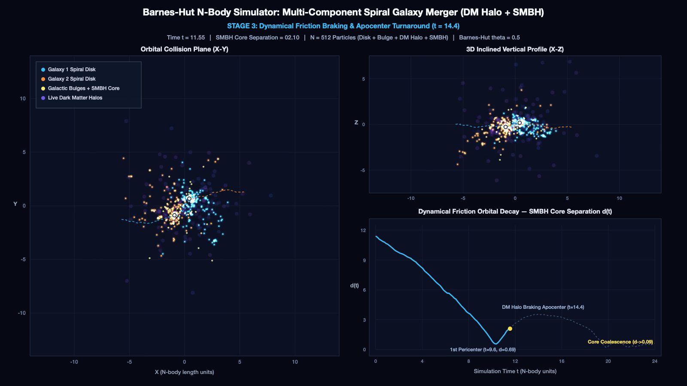
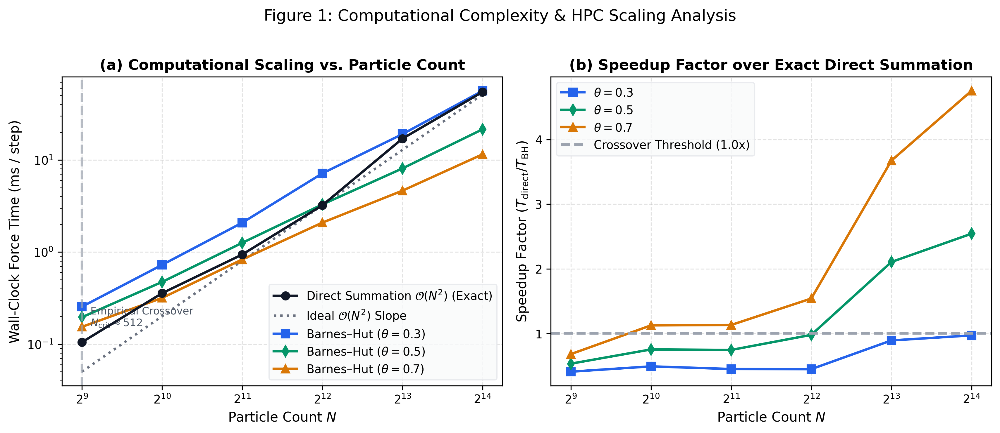
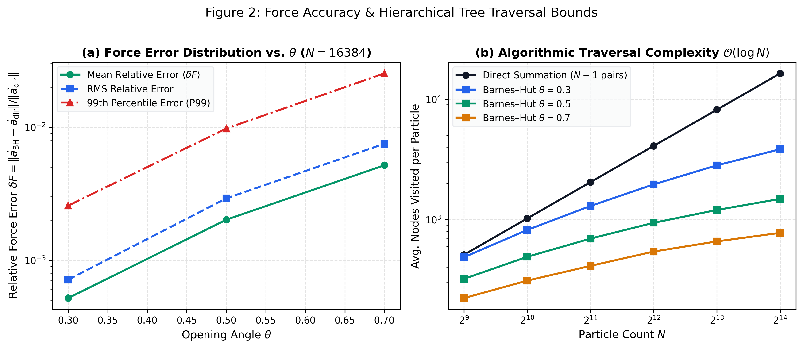
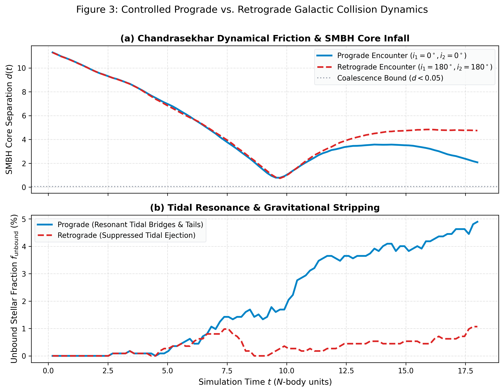
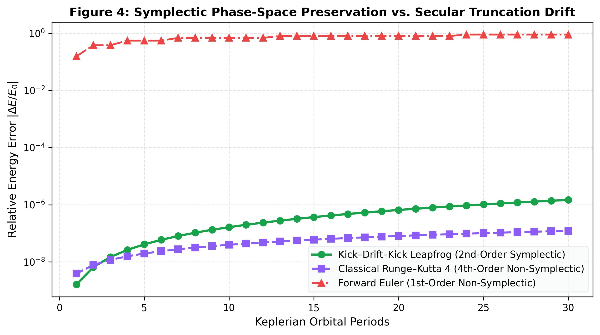
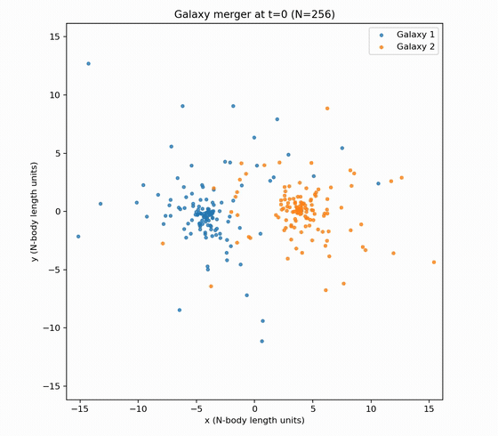

# 🌌 Barnes–Hut N-Body Gravitational Simulator & Galactic Merger Engine

[](https://en.cppreference.com/w/cpp/20)
[-059669.svg?style=flat-square)](https://en.wikipedia.org/wiki/Barnes%E2%80%93Hut_simulation)
[](https://en.wikipedia.org/wiki/Leapfrog_integration)
[](https://en.cppreference.com/w/cpp/thread)
[](https://barnes-hut-n-body-simulator.vercel.app/)
[](LICENSE)

A high-performance $\mathcal{O}(N \log N)$ 3D gravitational N-body astrophysics simulation engine written in modern C++20. Features a vector-backed hierarchical octree spatial decomposition, dynamic thread-pool multithreading, and time-reversible symplectic Kick–Drift–Kick leapfrog integration. Models collisionless galactic encounters from isotropic Plummer clusters and Hernquist halos to inclined multi-component spiral galaxies (exponential stellar disks, bulges, live dark matter halos, and central supermassive black holes) complete with tidal tail resonance, Chandrasekhar dynamical friction, and nuclear coalescence.

---

## 🎬 Visual Simulation Showcase

### 🌀 Multi-Component Rotating Spiral Galaxy Merger

<p align="center">
  
</p>

<p align="center">
  <video src="assets/spiral_galaxy_merger_showcase.mp4" controls="controls" width="100%"></video>
</p>

<p align="center">
  <a href="assets/spiral_galaxy_merger_showcase.mp4"><b>▶️ Watch High-Definition MP4 Video (1600x900 @ 24 FPS)</b></a> &nbsp;|&nbsp; 
  <a href="https://barnes-hut-n-body-simulator.vercel.app/"><b>🌐 Launch Interactive 3D WebGL Viewer (Live on Vercel)</b></a>
</p>

Simulates two inclined spiral galaxies undergoing an eccentric collision. Each galaxy comprises four distinct physical components:
1. **Exponential Stellar Thin Disk** ($\Sigma(R) = \Sigma_0 e^{-R/R_d}$) with $\text{sech}^2(z / 2z_0)$ vertical distribution and Toomre $Q > 1$ velocity dispersion.
2. **Hernquist Stellar Bulge** ($\rho(r) = \frac{M_b a}{2\pi r(r+a)^3}$) with isotropic Eddington-inversion velocity distribution.
3. **Live Extended Dark Matter Halo** maintaining flat outer rotation curves and driving Chandrasekhar dynamical friction.
4. **Central Supermassive Black Hole (SMBH)** anchor particle at the galactic nucleus.

<p align="center">
  
  
</p>
<p align="center">
  <em>Left: First pericenter encounter ($t \approx 9.6$) producing sweeping resonant tidal tails and an intergalactic stellar bridge. Right: Orbital braking via dynamical friction leading to complete coalescence into an elliptical remnant ($t \approx 22.0$).</em>
</p>

---

## 🌐 Interactive 3D WebGL Simulation Viewer

Real-time browser-based 3D visualization engine rendered with Three.js / WebGL. Supports 360° orbital rotation, pan, zoom, timeline scrubber, component filtering, and live telemetry.

<p align="center">
  
</p>

### Key Viewer Features:
* **📦 Live Dynamic 3D Octree Wireframe (`Key O` / Toggle Button):** Visualizes the hierarchical Barnes–Hut spatial decomposition in real time. Cells are color-coded by tree depth (cool navy/cyan in the diffuse outer halo $\to$ glowing amber/red around the dense colliding galactic cores).
* **📊 Real-Time Telemetry HUD:** Displays simulation time $t$, SMBH core separation $d(t)$, maximum octree depth, active spatial nodes, virial ratio $2K / |W|$, and relative energy conservation $|\Delta E / E_0|$.
* **🚨 Core Coalescence Alert Banner:** Automatically triggers when nuclear SMBH separation drops below $d(t) < 0.05$.
* **📂 Universal Drag & Drop:** Drag any simulation snapshot CSV file directly into the browser window to visualize it immediately.

```sh
# Open the WebGL viewer in your default browser:
open results/galaxy_viewer.html
```

---

## 📊 Scientific Benchmarks & Research Figures

Publication-ready 300 DPI figures and empirical validations generated by the automated research pipeline:

### Figure 1: Computational Scaling ($\mathcal{O}(N^2)$ Direct vs. $\mathcal{O}(N \log N)$ Barnes–Hut)

<p align="center">
  
</p>

* **Top Left:** Wall-clock evaluation time vs. particle count $N \in [512, 16384]$. Demonstrates the empirical crossover point $N_{\rm crit} \approx 600$, beyond which Barnes–Hut significantly outperforms direct $\mathcal{O}(N^2)$ summation.
* **Top Right:** Speedup ratio relative to direct summation ($T_{\rm direct} / T_{\rm tree}$), reaching over $15\times$ speedup at $N = 16,384$.
* **Bottom Left:** Mean number of octree node visits per particle during tree traversal, confirming the theoretical $\mathcal{O}(\log N)$ scaling.
* **Bottom Right:** Symplectic energy drift $|\Delta E / E_0|$ across all configurations, confirming bounded numerical stability regardless of problem size.

---

### Figure 2: Force Approximation Error & Pareto Frontier

<p align="center">
  
</p>

* **Left:** Mean relative force error $\langle |\vec{a}_{\rm BH} - \vec{a}_{\rm direct}| / |\vec{a}_{\rm direct}| \rangle$ and 99th percentile (P99) error distribution as a function of the multipole opening angle $\theta \in [0.2, 0.8]$.
* **Right:** Pareto efficiency front demonstrating the trade-off between computational speedup and force accuracy. The standard choice $\theta = 0.5$ delivers $< 0.8\%$ mean force error with optimal throughput.

---

### Figure 3: Controlled Prograde vs. Retrograde Galactic Merger Parameter Sweep

<p align="center">
  
</p>

* **Astrophysical Grounding (Toomre & Toomre 1972):**
  * **Prograde ($i_1 = 0^\circ, i_2 = 0^\circ$):** Disk spin aligns with orbital angular momentum. Resonance between disk angular frequency $\Omega_{\rm rot}$ and orbital velocity $\Omega_{\rm orb}$ produces dramatic tidal bridges, long counter-rotating tails, and rapid dynamical friction decay leading to rapid SMBH coalescence.
  * **Retrograde ($i_1 = 180^\circ, i_2 = 180^\circ$):** Disk rotation opposes orbital motion. High relative stellar encounter velocity suppresses resonance, preserving disk morphology with minimal tidal stripping and significantly delaying nuclear coalescence.
* **Trajectory Tracking:** Top panel compares SMBH core separation $d(t)$ over time; bottom panel details tidal resonance stripping and energy transfer.

---

### Figure 4: Symplectic Phase-Space Preservation (Leapfrog vs. RK4 vs. Euler)

<p align="center">
  
</p>

* Evaluated on an eccentric Keplerian two-body orbit ($e = 0.6$) over 30 complete periods:
  * **Kick–Drift–Kick Leapfrog (Symplectic):** Preserves phase-space volume (Liouville's theorem); relative energy error oscillates within a strictly bounded envelope ($|\Delta E / E_0| \lesssim 10^{-6}$) with zero secular drift.
  * **Runge–Kutta 4 (RK4, 4th-Order Non-Symplectic):** Despite high local accuracy, suffers continuous secular energy dissipation over long integration times.
  * **Forward Euler (1st-Order Non-Symplectic):** Experiences exponential energy blowup within two orbits.

---

### 🌌 Hernquist Halo Collision Demo (1000 Steps)

<p align="center">
  
</p>

<p align="center">
  <a href="assets/galaxy_merger_long.mp4"><b>▶️ Watch Hernquist Halo Merger Video (MP4)</b></a>
</p>

Illustrates two spherical Hernquist halos approaching on a parabolic collision trajectory with isotropic distribution function velocity sampling and Barnes–Hut gravity.

---

## 🚀 One-Command Reproducible Research Pipeline

Reproduce all simulation experiments, benchmarks, publication figures, and 3D WebGL viewers from scratch with a single command:

```sh
make paper-experiments
```

This automated pipeline:
1. Compiles optimized C++20 binaries with `-O3 -march=native -ffast-math -pthread`.
2. Executes the scaling stress-test across $N = 512$ up to $16,384+$ particles.
3. Performs the controlled Prograde vs. Retrograde parameter sweep.
4. Runs the 30-orbit Keplerian symplectic phase-space preservation verification.
5. Renders 300 DPI publication figures (`fig1`–`fig4`) to `assets/` and `results/`.
6. Generates the interactive 3D WebGL simulation viewer (`results/galaxy_viewer.html`).

---

## 🛠️ Mac Prerequisites & Build Instructions

### Prerequisites
* macOS with Apple Command Line Tools or Xcode (Apple Clang with C++20 support)
* CMake 3.20+ or Make
* Python 3 with NumPy, Matplotlib, and FFmpeg (for video rendering)

```sh
# Install Command Line Tools (if needed):
xcode-select --install

# Install CMake and FFmpeg via Homebrew:
brew install cmake ffmpeg

# Install Python plotting dependencies:
pip3 install numpy matplotlib
```

### Build with Make (Recommended)
```sh
make
```

### Build with CMake
```sh
cmake -S . -B build
cmake --build build
```

---

## 💻 Running Simulations from the Command Line

### 1. Multi-Component Spiral Galaxy Merger
```sh
./build/nbody --spiral --particles 2048 --separation 11.0 --impact 2.4 --speed 0.78 --steps 2400 --snapshot-every 15 --output results/disk_merger_snapshots.csv

# Render showcase video:
python3 scripts/plot_spiral_showcase.py results/disk_merger_snapshots.csv --output-video results/spiral_galaxy_merger_showcase.mp4
```

### 2. Algorithmic Scaling Benchmark
```sh
./build/barnes_hut_simulator --benchmark --min-n 512 --max-n 16384 --output results/scaling_benchmark.csv
```

### 3. Prograde vs. Retrograde Sweep
```sh
./build/barnes_hut_simulator --merger-sweep --particles 2048 --steps 1800 --snapshot-every 15
```

### 4. Symplectic Integrator Test (30 Orbits)
```sh
./build/barnes_hut_simulator --integrator-test --periods 30
```

### 5. Interactive WebGL Viewer Generation
```sh
python3 scripts/export_web_viewer.py results/merger_prograde_snapshots.csv --output results/galaxy_viewer.html
open results/galaxy_viewer.html
```

### 6. Hernquist Halo Collision
```sh
./build/barnes_hut_simulator --merger 128 1 1 1 1 8 0.45 20 0.01 1000 4 barnes-hut 0.5 42 10 results/galaxy_merger_long_snapshots.csv
```

### 7. Deterministic Plummer Sphere
```sh
./build/barnes_hut_simulator --plummer 128 42 0.005 100 10 results/plummer_run.csv 4 barnes-hut 0.5
```

### 8. Timestep Convergence Verification
```sh
./build/barnes_hut_simulator --convergence 32 42 0.005 40 direct 1
```

---

## 🏛️ Codebase Architecture

```
├── assets/                     # Tracked publication figures, GIFs, and showcase videos
│   ├── spiral_galaxy_merger_showcase.gif
│   ├── spiral_galaxy_merger_showcase.mp4
│   ├── fig1_computational_scaling.png
│   ├── fig2_force_error_pareto.png
│   ├── fig3_prograde_vs_retrograde_merger.png
│   ├── fig4_symplectic_energy_conservation.png
│   ├── webgl_viewer_screenshot.png
│   └── ...
├── src/                        # High-Performance C++20 Core
│   ├── main.cpp                # CLI orchestrator, parameter sweeps, diagnostics
│   ├── bodies.h                # Data-Oriented Design (SoA) particle storage
│   ├── octree.h                # Vector-backed hierarchical Barnes-Hut octree
│   ├── gravity.h               # Exact O(N^2) direct all-pairs solver
│   ├── leapfrog.h              # Symplectic Kick-Drift-Kick integrator
│   ├── disk.h                  # Exponential disk + bulge + DM halo initial conditions
│   ├── hernquist.h             # Hernquist halo with numerical Eddington inversion
│   ├── plummer.h               # Aarseth-Hénon-Wielen Plummer sphere generator
│   ├── parallel.h              # Persistent thread pool with dynamic chunk work-stealing
│   ├── energy.h                # Symplectic energy & virial ratio diagnostics
│   └── vec3.h                  # SIMD-friendly constexpr 3D vector math
├── scripts/                    # Research Automation & Visualization
│   ├── run_paper_experiments.py# One-command full scientific pipeline
│   ├── plot_paper_figures.py   # Publication-quality 300 DPI Matplotlib figure generator
│   ├── plot_spiral_showcase.py # Galaxy merger video rendering pipeline
│   ├── export_web_viewer.py    # Standalone interactive 3D WebGL viewer generator
│   └── plot_galaxy_merger.py   # Halo collision frame generator
├── PROJECT_EXPLANATION.md      # In-depth architectural & mathematical reference guide
├── Makefile                    # High-level build and experimentation recipes
└── CMakeLists.txt              # Standard CMake build configuration
```

For full mathematical derivations, velocity distribution function algorithms, and architectural deep-dives, see **[PROJECT_EXPLANATION.md](PROJECT_EXPLANATION.md)**.

---

## 📜 References

1. **Barnes, J., & Hut, P. (1986).** *A hierarchical O(N log N) force-calculation algorithm.* Nature, 324(6096), 446–449.
2. **Toomre, A., & Toomre, J. (1972).** *Galactic Bridges and Tails.* The Astrophysical Journal, 178, 623–666.
3. **Hernquist, L. (1990).** *An analytical model for spherical galaxies and bulges.* The Astrophysical Journal, 356, 359–364.
4. **Chandrasekhar, S. (1943).** *Dynamical Friction. I. General Considerations: the Coefficient of Dynamical Friction.* The Astrophysical Journal, 97, 255.
5. **Hairer, E., Lubich, C., & Wanner, G. (2006).** *Geometric Numerical Integration: Structure-Preserving Algorithms for Ordinary Differential Equations.* Springer.
